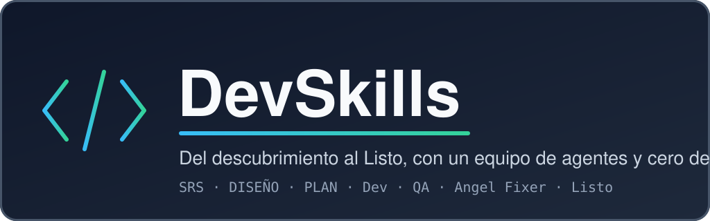

<p align="center">
  
</p>

<p align="center">
  <strong>Metodología y stack para construir cualquier sistema, nacida de un proyecto real</strong><br>
  Del descubrimiento al Listo con un equipo de agentes de Claude Code y cero deuda: inventarios, una plataforma escolar, una app interna de recursos humanos o lo que necesites.<br>
  SRS ISO/IEC/IEEE 29148 · DISEÑO IEEE 1016 · plan por sprints · Dev → QA → Angel Fixer.
</p>

<p align="center">
  
  
  
  
  
  
</p>

<p align="center">
  <a href="#-instalación">Instalación</a> •
  <a href="#-inicio-rápido">Inicio rápido</a> •
  <a href="#-agentes">Agentes</a> •
  <a href="#-skills">Skills</a> •
  <a href="#-comandos-del-cli">CLI</a> •
  <a href="#-generadores-de-contenido">Generadores</a> •
  <a href="#-documentación">Docs</a>
</p>

---

## Ejemplo

```
┌───────────────┐   ┌──────────┐   ┌──────────┐   ┌──────────┐
│ Descubrimiento│──▶│   SRS    │──▶│  DISEÑO  │──▶│   PLAN   │
│  con el PO    │   │ ISO 29148│   │ IEEE 1016│   │ sprints  │
└───────────────┘   └──────────┘   └──────────┘   └────┬─────┘
                                                       │
        ┌──────────────────────────────────────────────┘
        ▼
┌───────────────┐   ┌──────────┐   ┌─────────────┐   ┌──────────────┐   ┌───────────┐
│  Desarrollo   │──▶│    QA    │──▶│ Angel Fixer │──▶│ Verificación │──▶│ ✅ Listo  │
│ (Dev A / B)   │   │ Gherkin  │   │ evaluación  │   │ final, solo  │   │ (tachado) │
└───────────────┘   └──────────┘   └──────┬──────┘   │ si corrigió  │   └───────────┘
        ▲                                 │          └──────────────┘
        └──── cualquier hallazgo ◄────────┘   máximo 3 rondas
```

```console
$ devskills init ~/proyectos/inventarios --nombre "Sistema de Inventarios" --puerto-base 21000
Proyecto creado en ~/proyectos/inventarios
  raiz: 6 archivos
  codigo: 208 archivos
  documentacion: 13 archivos
  analisis: 7 archivos
  prefijo de Docker y proyecto de engram: inventarios
  rango de puertos del host: 21000-21049
  primer commit: chore: bootstrap project from devskills

$ cd ~/proyectos/inventarios && claude
> /devskills:ciclo HU-01
```

## 🎯 ¿Por qué?

Tienes una idea de sistema. Le pides código a un agente y sale rápido… hasta que nadie sabe qué se pidió, qué se probó ni qué quedó pendiente.

**DevSkills** pone orden antes y durante: requisitos y diseño por escrito, un equipo de agentes con roles separados, y un ciclo de calidad en el que nada se da por terminado con hallazgos abiertos. Es el método con el que ya se construyó un sistema real, empaquetado para el siguiente, **sea del dominio que sea**: el método no presupone actores, procesos ni integraciones; todo eso sale del descubrimiento y del SRS de cada proyecto.

- 📋 **Requisitos antes que código** — SRS con historias en Gherkin y trazabilidad generada (requisito → caso de uso → historia)
- 👥 **Un equipo, no un agente** — analista, dos desarrolladores, QA, Angel Fixer y verificador, coordinados por un orquestador que no escribe código
- 🚫 **Cero deuda** — todo hallazgo, de cualquier severidad, se corrige antes de tachar
- 💾 **Ningún trabajo sin respaldo** — rama por elemento y commit de punto de control antes de cada revisión
- 🧱 **Stack fijo y probado** — Django modular hexagonal con identidad, permisos, outbox y despliegue ya hechos y con sus pruebas
- 🖨️ **Todo se genera** — plan y tablero de sprints, Anexo C, documentos Word, presentación y transcripción de la sesión
- 🪟 **Multiplataforma** — macOS, Linux y Windows (Git Bash y PowerShell)

---

## 📦 Instalación

### Plugin de Claude Code (recomendado)

```text
/plugin marketplace add ssdarm150120-gif/DevSkills
/plugin install devskills@devskills-local
```

### Manual

```bash
git clone https://github.com/ssdarm150120-gif/DevSkills.git
cd DevSkills
./install.sh
```

### Windows (Git Bash)

```bash
git clone https://github.com/ssdarm150120-gif/DevSkills.git
cd DevSkills
bash install.sh
```

### Windows (PowerShell)

```powershell
git clone https://github.com/ssdarm150120-gif/DevSkills.git
cd DevSkills
powershell -ExecutionPolicy Bypass -File install.ps1
```

El instalador copia los agentes y las skills a `~/.claude` con el prefijo `devskills-`, instala el CLI `devskills` y registra cada archivo en un manifiesto. No pisa nada tuyo sin preguntar, y `uninstall.sh` / `uninstall.ps1` quitan exactamente lo instalado.

> 📖 Ver [docs/instalacion.md](docs/instalacion.md) para el detalle de cada forma, la actualización y los requisitos.

---

## 🚀 Inicio rápido

```bash
devskills doctor                                   # obligatorios: git, Python 3.12, Claude Code, gitleaks · opcionales: Docker, semgrep, Node, mermaid-cli, gh, engram
# Dos caminos al mismo resultado (el descubrimiento va ANTES de fijar nombre, slug y puertos):
#  A) Recomendado, dentro de Claude Code, desde una carpeta cualquiera:
#       /devskills:nuevo-proyecto   descubrimiento con el Product Owner y, con sus respuestas, crea la carpeta del
#                                   proyecto (el mismo `devskills init` por debajo), CONTEXTO y SRS 0.1
#  B) Manual, si ya sabes el nombre y los puertos:
devskills init ~/proyectos/mi-sistema --nombre "Mi sistema" --puerto-base 21000   # estructura + esqueleto + primer commit
cd ~/proyectos/mi-sistema && claude                # abre Claude Code en el proyecto
# Dentro de Claude Code:
#   /devskills:nuevo-proyecto     detecta la carpeta ya creada, salta ese paso y hace el descubrimiento con el
#                                 Product Owner, el CONTEXTO y el SRS 0.1
#   (el analista-arquitecto redacta el SRS, el DISEÑO y el PLAN)
#   /devskills:ciclo EN-01        desarrollo → QA → Angel Fixer → Listo
#   /devskills:guarda-todo        commit, transcripción, gitleaks y memoria al cerrar la sesión
```

> 📖 Ver [docs/metodologia.md](docs/metodologia.md) para el flujo completo de un proyecto.

---

## 👥 Agentes

| Agente | Qué hace |
|--------|----------|
| `orquestador` | Coordina al equipo, decide lo técnico, pregunta lo de negocio y hace los commits. No escribe código |
| `analista-arquitecto` | Redacta y versiona el SRS, el DISEÑO y el PLAN; mantiene preguntas, riesgos y trazabilidad |
| `dev-a` | Desarrollador A: dominio y datos, y los habilitadores de cimientos |
| `dev-b` | Desarrollador B: interfaz, experiencia y servicios |
| `dev-dominio` | Entidades, máquinas de estado y casos de uso, con TDD |
| `dev-integraciones` | Adaptadores, outbox, Celery y migraciones |
| `dev-interfaz` | Vistas Django + HTMX, accesibilidad y formatos |
| `dev-servicios` | Servicios internos separados del monolito |
| `qa` | Valida contra el Gherkin del SRS y los requisitos no funcionales; emite el veredicto |
| `qa-bdd` | Convierte los escenarios Gherkin en pruebas pytest-bdd |
| `qa-no-funcional` | Verifica seguridad, rendimiento, accesibilidad y privacidad |
| `angel-fixer` | Evalúa cumplimiento, buenas prácticas y seguridad; corrige lo crítico y lo alto |
| `verificador` | Verificación final de una sola pasada o de una lista congelada |

> 📖 Ver [docs/agentes.md](docs/agentes.md) para la jerarquía, las skills precargadas y las reglas de cada uno.

---

## 🧩 Skills

| Skill | Para qué |
|-------|----------|
| `nuevo-proyecto` · `iniciar-proyecto` | Descubrimiento con el Product Owner y creación del proyecto |
| `redactar-srs` | SRS ISO/IEC/IEEE 29148 paso a paso |
| `redactar-diseno` | DISEÑO IEEE 1016 y decisiones de arquitectura |
| `planear-entregas` | Entregas, sprints, puntos y tablero |
| `pasada-documental` | Subir de versión SRS y DISEÑO con historial, Anexo C, plan y Word |
| `evaluacion-alternativas` | Comprar o construir: evaluar un producto existente |
| `prompts-figma` | Prompts de Figma Make derivados del SRS |
| `generar-presentacion` | Presentación de la propuesta en `.pptx` |
| `ciclo` · `ciclo-historia` | Ciclo completo de un elemento o de un sprint |
| `implementar-historia` | Desarrollo con TDD, arquitectura hexagonal y lecciones aprendidas |
| `validar-historia` | Validación de QA con veredicto |
| `registrar-avance` | Reporte, estado oficial y plan tachado |
| `angel-fixer` | Evaluación y remediación |
| `gga` | Auditoría de seguridad con dos auditores ciegos |
| `judgment-day` | Revisión adversarial con dos jueces ciegos |
| `preguntar-al-po` | Decisiones numeradas con opción recomendada, por terminal o Telegram |
| `guarda-todo` | Cierre de sesión |
| `recuperar-corte` | Retomar a un agente que se cortó, sin rehacer |
| `orquestador` · `proyecto-contexto` | Reglas de la sesión principal y contexto del proyecto |

> 📖 Ver [docs/skills.md](docs/skills.md) para el detalle de cada skill.

---

## 📋 Comandos del CLI

| Comando | Descripción |
|---------|-------------|
| `devskills init <ruta>` | Crea un proyecto nuevo con la estructura y el esqueleto |
| `devskills doctor` | Revisa los requisitos y explica cómo instalar lo que falte |
| `devskills update [--si]` | Muestra los cambios del clon de origen, pide confirmación y reinstala |
| `devskills version` | Muestra la versión |
| `devskills help` | Muestra la ayuda |

Opciones de `init`: `--nombre`, `--slug`, `--puerto-base`, `--puertos-reservados`, `--autor`, `--sin-git`. El nombre y el autor no admiten saltos de línea, comillas dobles, `\`, `$`, `#`, `{`, `}` ni acento grave (romperían TOML, JSON, YAML o `.env`).

---

## 🖨️ Generadores de contenido

| Genera | Con | Skill |
|--------|-----|-------|
| `PLAN.md` y el tablero de sprints (`plan_sprints.html`) | `analisis/plan_sprints.py` | `planear-entregas`, `registrar-avance` |
| Anexo C de trazabilidad del SRS | `analisis/trazabilidad.py` | `redactar-srs`, `pasada-documental` |
| Documentos Word con diagramas Mermaid | `analisis/md_a_word.py` | `pasada-documental` |
| Presentación de la propuesta (`.pptx`) | `presentacion/generar_presentacion.js` | `generar-presentacion` |
| Transcripción de la sesión en Markdown | `analisis/exportar_sesion.py` | `guarda-todo` |
| Prompts de Figma Make | `ui/prompts_figma_make.md` | `prompts-figma` |
| Evaluación de alternativas | `EVALUACION_ALTERNATIVAS.md` | `evaluacion-alternativas` |

> 📖 Ver [docs/generadores.md](docs/generadores.md) para los comandos y las dependencias de cada uno.

---

## 🔁 Cómo funciona el ciclo

- **Rondas:** desarrollo → QA → Angel Fixer. Cualquier hallazgo vuelve al desarrollador con la lista exacta. Máximo 3 rondas; después decide el Product Owner.
- **Lista congelada:** una ronda extra solo resuelve y verifica lo pendiente, sin abrir búsquedas nuevas.
- **Cero deuda:** hallazgos críticos, altos, medios y bajos bloquean el Listo. Lo que es de otro elemento se anota con su ID.
- **Puntos de control:** rama por elemento, commit `wip` antes de cada revisión, y squash a `main` al cerrar. Nadie reconstruye un archivo de memoria.
- **Quién decide:** el Product Owner lo de negocio; el orquestador lo técnico. Todo queda registrado con quién lo decidió.

> 📖 Ver [docs/metodologia.md](docs/metodologia.md) · [docs/stack.md](docs/stack.md) · [docs/telegram.md](docs/telegram.md)

---

## ✅ Requisitos

**Obligatorios:** Git · Claude Code · Python 3.12 · gitleaks (binario nativo; Docker es la alternativa).

**Opcionales:** Docker (solo para desplegar o reproducir el stack completo; **no hace falta para desarrollar ni probar**) · semgrep local (nativo en macOS y Linux, WSL o Docker en Windows; en el CI de GitHub siempre corre) · Node.js LTS y mermaid-cli (presentación y diagramas de los Word) · GitHub CLI · plugin engram.

Corre `devskills doctor` para revisarlos. Para correr sin humano (`claude -p`, `--resume` tras un corte, costo y cómo abaratarlo), ver [Uso no interactivo](docs/instalacion.md#uso-no-interactivo); para el CI del proyecto, [GitHub CLI (`gh`) y el CI](docs/instalacion.md#github-cli-gh-y-el-ci).

---

## ❓ Preguntas frecuentes

**¿Para qué tipo de sistemas sirve?** Para cualquiera que quepa en una aplicación web con el stack fijo: un sistema de inventarios, una plataforma escolar, una app interna de recursos humanos, una mesa de servicio… El esqueleto solo trae lo genérico (configuración, núcleo, identidad, herramientas y despliegue) y un único rol, Administrador; los módulos de negocio, los demás roles y las integraciones los define el SRS de tu proyecto.

**¿Puedo cambiar el stack?** No dentro de DevSkills: el stack es fijo a propósito, porque el esqueleto ya trae identidad, permisos, outbox y despliegue probados. Lo que cambia por proyecto son los módulos de negocio.

**¿Sirve para un repositorio que ya tiene código?** `devskills init` es para proyectos nuevos. En uno existente puedes usar los agentes, las skills y los generadores, adaptando la estructura a mano.

**¿Qué diferencia hay entre el plugin y el instalador?** Solo los nombres: `devskills:ciclo` con el plugin, `devskills-ciclo` con el instalador. El contenido es el mismo.

**¿Necesito Docker?** No. Se desarrolla y se prueba sin él: la base es un PostgreSQL embebido, Celery corre en modo local y gitleaks y semgrep tienen versión nativa (semgrep en Windows, por WSL o Docker; en el CI de GitHub siempre corre). Docker Compose es la forma de **desplegar**. `devskills doctor` lo avisa como opcional y dice qué pierdes sin él. Detalle en [Docker es opcional](docs/instalacion.md#docker-es-opcional).

**¿Un agente puede subir mi código o escribir en GitHub?** No sin que lo confirmes: `git push`, `gh` de escritura, merges de Dependabot y publicar lecciones en el repositorio de DevSkills se proponen y se ejecutan solo con tu "sí". Además, un hook del plugin bloquea esos comandos a los subagentes, y en corridas sin humano hay [permisos mínimos y vetos explícitos](docs/instalacion.md#uso-no-interactivo).

**¿Necesito Telegram?** No. Es opcional, para dirigir al orquestador desde el celular.

**¿En qué idioma trabaja?** Todo el contenido está en español de México. Los commits van en inglés con Conventional Commits.

---

## 📚 Documentación

| Tema | Descripción |
|------|-------------|
| [Metodología](docs/metodologia.md) | Flujo completo, ciclo por historia y reglas |
| [Agentes](docs/agentes.md) | Jerarquía, roles y reglas de cada agente |
| [Skills](docs/skills.md) | Qué hace cada skill y cuándo se usa |
| [Generadores](docs/generadores.md) | Plan y tablero, Anexo C, Word, presentación, sesión |
| [Stack](docs/stack.md) | El esqueleto de código y cómo extenderlo |
| [Instalación](docs/instalacion.md) | Plugin, instalador, actualización y requisitos |
| [Telegram](docs/telegram.md) | Trabajar desde el celular |
| [Cambios](CHANGELOG.md) | Historial de versiones |

---

## 🤝 Contribuir

Lee [CONTRIBUTING.md](CONTRIBUTING.md): primero un issue, después el pull request. Los estándares del repositorio están en [AGENTS.md](AGENTS.md).

---

## 📄 Licencia

[MIT](LICENSE)
