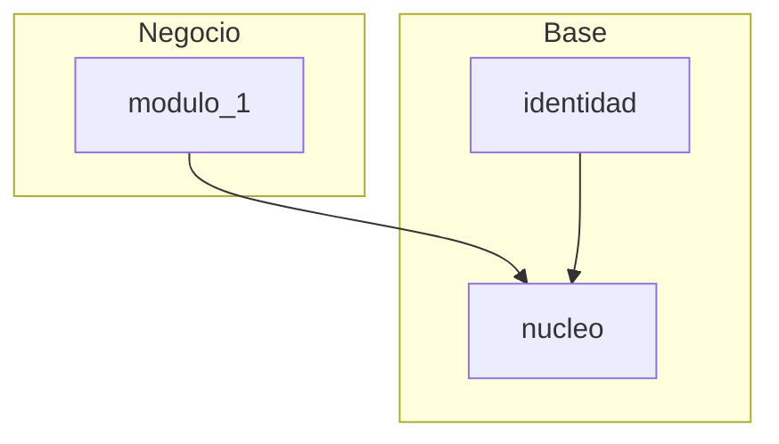
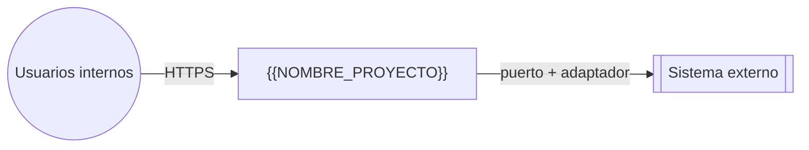
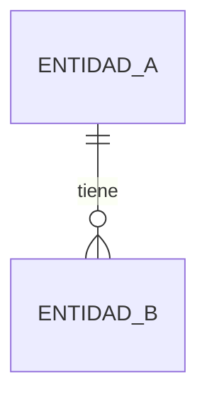
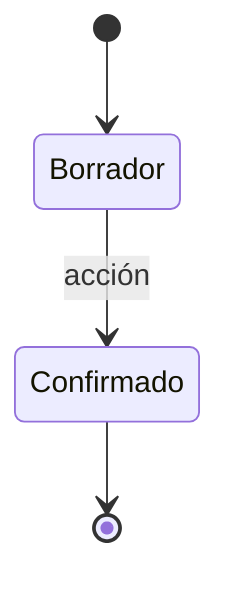
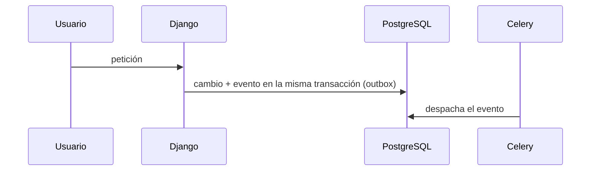
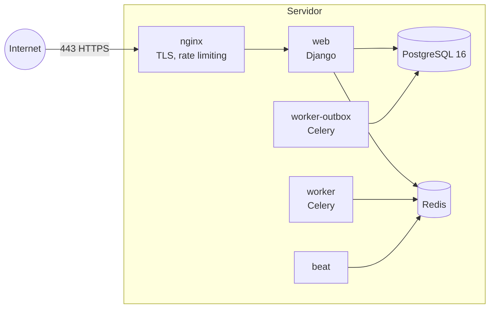

# Documento de Diseño de Software (SDD)
## {{NOMBRE_PROYECTO}}

| Campo | Valor |
|-------|-------|
| Versión | 0.1 (borrador) |
| Fecha | {{FECHA}} |
| Autor | {{AUTOR}} |
| Estándar de referencia | IEEE 1016-2009 (Software Design Descriptions) |
| Requisitos de origen | `documentacion/SRS.md`, versión <!-- X.Y --> |
| Estado | Borrador: D.1 en curso |

> **Regla del documento:** el SRS dice **qué** hace el sistema; este documento dice **cómo**. Aquí no se copian requisitos: se **referencian** por su ID (RF, RNF, CU, HU). Si una decisión de diseño obliga a cambiar un requisito, primero se cambia el SRS.

<!--
Cómo se mantiene (skills devskills:redactar-diseno y devskills:pasada-documental):
- Se escribe en orden D.1 → D.6; cada paso se valida con el Product Owner antes del siguiente.
- Cada pasada sube la versión, agrega una fila al historial (la más reciente arriba) y dice con qué
  versión del SRS queda alineado, con "Decisiones del Product Owner" y "Decisiones del orquestador".
- Si un desarrollador encuentra que el diseño no define algo que necesita (por ejemplo, los métodos
  de un puerto o dónde vive), se detiene y el hueco se cierra aquí antes de escribir código.
- Cualquier flecha nueva entre módulos se agrega PRIMERO en el diagrama de D.1.3 y en
  `codigo/configuracion/modulos.py`: el CI (import-linter) rechaza la que no esté ahí.
- Lo marcado "heredado del esqueleto DevSkills" ya está implementado y probado en `codigo/`.
-->

### Plan del diseño
| Paso | Contenido | Estado |
|------|-----------|--------|
| D.0 | Introducción: propósito, alcance, glosario, referencias, partes interesadas y preocupaciones | En curso |
| D.1 | Mapa de módulos, puertos y adaptadores (incluye la vista de contexto, D.1.7) | En curso |
| D.2 | Modelo de datos | Pendiente |
| D.3 | Máquinas de estado | Pendiente |
| D.4 | Flujos de integración (diagramas de secuencia) | Pendiente |
| D.5 | Contratos: APIs internas y eventos | Pendiente |
| D.6 | Despliegue y seguridad | Pendiente |
| D.7 | Algoritmos | Pendiente (solo si hay lógica no trivial) |

### Historial de cambios
| Versión | Fecha | Cambios |
|---------|-------|---------|
| 0.1 | {{FECHA}} | Borrador inicial con las decisiones heredadas del esqueleto DevSkills (ADR-001 a ADR-008) |

---

## D.0 Introducción

<!-- IEEE 1016 pide, antes de las vistas, el propósito, el alcance, las definiciones, las referencias y las
partes interesadas con sus preocupaciones. Lo llena el analista al abrir el documento y se revisa en cada pasada. -->

### D.0.1 Propósito
<!-- Para quién es este diseño y qué decisiones permite tomar: desarrolladores (qué construir y dónde), QA
(qué contratos probar), operación (cómo se despliega) y el Product Owner (qué se decidió). -->

### D.0.2 Alcance
<!-- Qué cubre este diseño (el sistema {{NOMBRE_PROYECTO}} y sus módulos) y qué NO (lo que otros equipos operan:
sistemas externos, infraestructura del cliente). Debe coincidir con el alcance del SRS 1.2. -->

### D.0.3 Definiciones, acrónimos y glosario
| Término | Definición |
|---------|------------|
| Puerto / adaptador | Interfaz que define el dominio / pieza que la implementa para una tecnología o sistema concretos |
| ADR | Registro de una decisión de arquitectura (D.1.6) |
| Outbox | Tabla donde se guarda, en la misma transacción, todo envío hacia afuera para despacharlo después con reintentos |
| <!-- término del dominio o de la arquitectura --> | <!-- definición; los términos del negocio son los del SRS 1.3 --> |

### D.0.4 Referencias
- IEEE 1016-2009, Software Design Descriptions.
- `documentacion/SRS.md`, versión <!-- X.Y -->: los requisitos (RF, RNF, CU, HU) que este diseño referencia por ID.
- `documentacion/PLAN.md`: entregas y sprints. `documentacion/CONTEXTO.md`: módulos, asignación y entorno.
- <!-- documentación técnica de los sistemas externos y de las normas aplicables (SRS 4.1) -->

### D.0.5 Partes interesadas y preocupaciones
<!-- IEEE 1016 relaciona cada parte interesada con sus preocupaciones y con la vista de este documento que las
atiende. Si una preocupación no tiene dónde atenderse, falta una vista o un ADR. -->

| Parte interesada | Preocupación | Dónde se atiende |
|------------------|--------------|------------------|
| Product Owner | Que el diseño cumpla las metas del SRS 1.1.1 sin alcance escondido | D.1.2 (módulos y requisitos), D.1.6 (ADR) |
| Usuarios | Rapidez, claridad y accesibilidad | SRS RNF, D.5 (rutas y permisos) |
| Desarrolladores | Límites claros, contratos de los puertos y qué tocar | D.1.3 a D.1.5, D.5 |
| QA | Contratos y estados verificables | D.3, D.5, adaptadores falsos (D.1.4) |
| Seguridad y cumplimiento | Datos personales, permisos, trazabilidad de acciones | D.6.3, SRS 4.1 |
| Operación | Despliegue, respaldo, observabilidad y recuperación | D.6 |
| <!-- otra parte interesada --> | <!-- preocupación --> | <!-- sección --> |

---

## D.1 Mapa de módulos, puertos y adaptadores

### D.1.1 Principios
1. **Monolito modular** (SRS 2.7): un solo despliegue de Django, dividido en módulos con límites estrictos. Cualquier módulo se puede extraer como servicio más adelante sin reescribirlo.
2. **Arquitectura que "grita" el dominio:** las carpetas se llaman como el negocio, no como la tecnología (`models`, `views`, `utils`).
3. **Hexagonal dentro de cada módulo:** dominio (reglas puras, sin Django ni SQL), aplicación (los casos de uso del Anexo A, un archivo por caso de uso), y adaptadores de entrada (web, webhook, tareas) y de salida (ORM, sistemas externos).
4. **Cada módulo es dueño de sus datos.** Ningún módulo lee ni escribe las tablas de otro: le pide los datos a su **interfaz pública** (`api_publica.py`) o reacciona a sus **eventos**. Entre módulos, las referencias son **por ID**, sin claves foráneas cruzadas.
5. **Todo lo externo va detrás de un puerto** (una interfaz definida por el dominio). Los sistemas externos son detalles reemplazables y simulables en las pruebas, con un adaptador falso y una prueba de contrato por puerto.

### D.1.2 Módulos

| # | Módulo | Responsabilidad | Requisitos | Casos de uso |
|---|--------|-----------------|------------|--------------|
| 0 | `nucleo` | Heredado del esqueleto: `Actor`, matriz de permisos, puertos compartidos (`nucleo/puertos/`), reloj, outbox de eventos con despachador, reintentos, purga y filtro de datos sensibles, reserva de identificadores | — | — |
| 1 | `identidad` | Heredado del esqueleto: usuarios, roles, ingreso con contraseña, bloqueo, sesión, segundo factor, gestión de usuarios, aviso por reuso del código | <!-- RF-ADM-* --> | <!-- CU --> |
| <!-- n --> | <!-- `modulo` --> | <!-- responsabilidad --> | <!-- RF-ABC-* --> | <!-- CU-nn a CU-nn --> |

<!-- `configuracion` no es un módulo de negocio: compone los adaptadores al arrancar y guarda los settings por entorno. -->

### D.1.3 Dependencias entre módulos

Las flechas significan "usa la interfaz pública de". No hay ciclos: si dos módulos se necesitan mutuamente, uno de los dos se comunica por **eventos**.



<!-- Este grafo es la fuente de `codigo/configuracion/modulos.py`, de donde se generan los contratos
de import-linter (`python -m herramientas.contratos_importlinter --escribir`, desde `codigo/`). Nadie importa `identidad`: los
casos de uso reciben el `Actor` de `nucleo`. Debajo del diagrama, lista los eventos que cruzan módulos: -->

| Evento | Emisor | Consumidores |
|--------|--------|--------------|
| <!-- `AlgoOcurrio` --> | <!-- módulo --> | <!-- módulos --> |

### D.1.4 Puertos y adaptadores hacia sistemas externos

| Puerto (lo define el dominio) | Adaptador MVP | Adaptador futuro | Lo usan |
|-------------------------------|---------------|------------------|---------|
| <!-- `PuertoAlgo` (métodos y errores tipados: reintentable o no) --> | <!-- adaptador real; adaptador falso para desarrollo y pruebas --> | <!-- — --> | <!-- módulos --> |

<!-- Los puertos compartidos por varios módulos viven en `nucleo/puertos/` (Python puro, protegidos por
el contrato "dominio puro"). Producción se niega a arrancar con un adaptador falso. Si un puerto es de
solo lectura por restricción del SRS, el puerto de escritura existe sin implementación. -->

### D.1.5 Estructura de carpetas (ejemplo con el módulo `<modulo>`)

```
codigo/
├── nucleo/                     # actor, permisos, puertos compartidos, reloj, outbox
├── identidad/                  # heredado del esqueleto
├── <modulo>/
│   ├── dominio/                # entidades, reglas y eventos (Python puro)
│   ├── aplicacion/             # un caso de uso por archivo, con el nombre del CU
│   │   └── puertos.py          # interfaces que este módulo necesita de afuera
│   ├── adaptadores/
│   │   ├── entrada/            # vistas web, API, tareas de Celery
│   │   └── salida/             # repositorio con el ORM de Django, adaptadores externos
│   ├── api_publica.py          # lo ÚNICO que otros módulos pueden importar
│   └── pruebas/                # pruebas por capa + escenarios Gherkin (pytest-bdd)
├── configuracion/              # settings por entorno, composición de adaptadores, modulos.py
├── herramientas/               # generador de contratos, roles de la base, utilidades
└── despliegue/                 # Dockerfile, Compose, nginx
```

**Regla que se verifica en CI:** un módulo solo puede importar el `api_publica.py` de otro módulo, o el `nucleo`. Se controla con `import-linter`: si alguien importa `<modulo>.adaptadores` desde otro módulo, el build falla.

### D.1.6 Decisiones de arquitectura (ADR)

| ADR | Decisión | Alternativa descartada | Motivo |
|-----|----------|------------------------|--------|
| ADR-001 | Monolito modular en Django (heredado del esqueleto DevSkills) | Microservicios desde el inicio | Los microservicios agregan red, despliegue y consistencia distribuida sin beneficio a esta escala. Los límites de los módulos permiten separarlos después |
| ADR-002 | Hexagonal por módulo con límites verificados por máquina: contratos de import-linter **generados** desde `configuracion/modulos.py`, más pruebas AST de dominio puro y sin imports dinámicos (heredado del esqueleto) | Revisión manual de los límites | Un límite que no se verifica en CI se rompe |
| ADR-003 | Eventos de dominio en proceso, más el **patrón outbox** para todo lo que sale hacia afuera (heredado del esqueleto) | Enviar directo a la API dentro de la transacción | Si el envío falla o el proceso se cae, el mensaje no se pierde ni se duplica: queda guardado en la misma transacción y Celery lo despacha con reintentos |
| ADR-004 | Puertos compartidos en `nucleo/puertos/`, con un adaptador falso y una prueba de contrato por puerto (heredado del esqueleto) | Cada módulo define su copia del puerto | Una sola definición; los adaptadores reales reutilizan la misma batería de contrato |
| ADR-005 | **Matriz de permisos central** en `nucleo/permisos.py`: capacidades por rol con denegación por defecto; los casos de uso la consultan con el `Actor` (heredado del esqueleto) | Permisos dispersos en las vistas | Una sola fuente del permiso, verificada en el caso de uso y no solo en la vista |
| ADR-006 | **Modelo de usuario propio en `identidad`** con correo como identificador, Argon2, bloqueo por cuenta, sesión con sello y tope, y segundo factor TOTP con secreto cifrado (heredado del esqueleto) | `django.contrib.auth` sin cambios | Control de la sesión y del segundo factor con falla cerrado |
| ADR-007 | **Mínimo privilegio en PostgreSQL:** un rol dueño de las migraciones y un rol de la aplicación que solo hace DML (heredado del esqueleto, `herramientas/roles_bd.py`) | Un solo usuario con todos los permisos | Una inyección o un error de la aplicación no puede alterar el esquema |
| ADR-008 | Settings por entorno (dev, pruebas, prod) con **validación del entorno al arrancar**; Docker Compose con nginx TLS, PostgreSQL, Redis, Celery `worker`, `worker-outbox` y `beat` (heredado del esqueleto) | Configuración libre | Producción falla al arrancar si falta un secreto o es débil |
| <!-- ADR-009 --> | <!-- decisión del proyecto --> | <!-- alternativa --> | <!-- motivo; "Decisión del Product Owner" si es de negocio --> |

<!-- Un ADR rechazado conserva su fila: "**Rechazado (AAAA-MM-DD):** ... Ver `documentacion/EVALUACION_ALTERNATIVAS.md`". -->

### D.1.7 Vista de contexto
<!-- IEEE 1016, punto de vista de contexto: el sistema como una caja, con los actores y los sistemas externos
que lo rodean y las interfaces entre ellos. Parte del SRS 2.1 y 5, pero aquí con la mirada del diseño: cada
flecha es un puerto (D.1.4) o una ruta de la interfaz de usuario (D.5). Si no hay sistemas externos,
dibuja solo los actores y escribe "Sin integraciones externas". -->



| Interfaz con el entorno | Sentido | Mecanismo | Puerto o ruta | Quién la opera |
|-------------------------|---------|-----------|---------------|----------------|
| Usuarios internos | Entrada | Web (HTTPS) | Rutas de D.5 | Equipo del proyecto |
| <!-- sistema externo --> | <!-- lectura / escritura --> | <!-- API, webhook, base en solo lectura --> | <!-- PuertoAlgo (D.1.4) --> | <!-- responsable --> |

---

## D.2 Modelo de datos

### D.2.1 Convenciones
- **PostgreSQL 16.** Un esquema por módulo, más `nucleo` (outbox).
- **Propiedad:** cada tabla pertenece a un solo módulo. Las referencias **entre módulos** son columnas de ID **sin clave foránea** (en los diagramas, con la etiqueta "ref"). Dentro de un módulo sí hay claves foráneas.
- **Identificadores:** UUID internos; además, folios legibles para las personas si el negocio los usa.
- **Dinero:** siempre el par `monto NUMERIC(14,4)` + `moneda CHAR(3)` (ISO 4217). Nunca se suman monedas distintas.
- **Fechas:** `TIMESTAMPTZ` en UTC. La zona horaria se aplica solo al mostrar.
- **Teléfonos** en formato E.164.
- **Secretos y tokens:** los tokens se guardan **hasheados**; las credenciales, cifradas.
- **Migraciones:** solo hacia adelante y compatibles con la versión anterior.
- <!-- convenciones propias del proyecto (purga física o lógica, archivos en almacenamiento S3, etc.) -->

### D.2.2 <!-- Núcleo del negocio -->



### D.2.3 Catálogo de entidades por módulo

| Módulo | Entidades (tablas) | Notas |
|--------|--------------------|-------|
| `identidad` | Heredado del esqueleto: Usuario, Rol, UsuarioRol, IntentoIngreso, AccionCuenta, SegundoFactor y las del aviso por reuso | <!-- ajustes del proyecto --> |
| `nucleo` | Heredado del esqueleto: eventos del outbox, entregas por consumidor, reservas de identificadores | — |
| <!-- `modulo` --> | <!-- entidades --> | <!-- notas --> |

### D.2.4 Índices y restricciones importantes
| Tabla | Restricción o índice | Por qué |
|-------|---------------------|---------|
| <!-- tabla --> | <!-- UNIQUE / ÍNDICE --> | <!-- requisito o HU que lo exige --> |

---

## D.3 Máquinas de estado

> **Regla de implementación:** cada máquina vive en el **dominio** de su módulo como una tabla de transiciones permitidas. Cualquier transición que no esté en la tabla **lanza un error**; nunca se asigna el estado "a mano". Cada transición emite un evento (D.5.2).

### D.3.1 <!-- Entidad --> (módulo `<modulo>`)



<!-- Debajo: quién puede ejecutar cada transición y qué evento emite. -->

---

## D.4 Flujos de integración

> Cada diagrama muestra el **tiempo**: qué es síncrono (la persona espera) y qué es asíncrono (Celery). Debajo de cada uno van los **puntos de falla** y cómo se manejan.

### D.4.1 <!-- Flujo --> (<!-- RF, RNF -->)



**Puntos de falla:** <!-- qué pasa si cae el sistema externo, si llega duplicado, si expira -->

---

## D.5 Contratos

### D.5.1 Reglas de los eventos de dominio
- **Nombre en pasado** (`AlgoOcurrio`): un evento informa algo que **ya ocurrió**; no es una orden.
- **Payload mínimo y autosuficiente:** IDs, los datos que los consumidores necesitan para no tener que volver a consultar, `ocurrido_en` (UTC) y `version_esquema`.
- **Entrega:** los eventos se guardan en la misma transacción que el cambio (tabla del outbox) y se despachan con Celery. Los consumidores son **idempotentes**: procesar dos veces el mismo `evento_id` no tiene efecto.
- **Evolución:** solo se **agregan** campos. Para un cambio incompatible se crea `NombreEventoV2` y conviven los dos hasta migrar a los consumidores.
- **Quién publica:** cada módulo **solo publica sus propios eventos**; el publicador rechaza un evento cuyo emisor no coincide con el catálogo (heredado del esqueleto).
- **Suscribir tarde no reentrega:** un consumidor que se registra después de publicado un evento no lo recibe.
- **Reintentos y retención:** los del despachador del esqueleto (espera exponencial con tope y máximo de reintentos; purga de lo ya entregado). <!-- ajusta los valores del proyecto y quién los decidió -->
- **Sin datos personales en los eventos:** ni las claves ni los valores llevan correos, teléfonos, contraseñas, códigos, tokens ni IP; el filtro del esqueleto lo verifica.

### D.5.2 Catálogo de eventos

| Evento | Emisor | Payload principal | Consumidores |
|--------|--------|-------------------|--------------|
| <!-- `AlgoOcurrio` --> | <!-- módulo --> | <!-- campos --> | <!-- módulos --> |

### D.5.3 Interfaces públicas de los módulos (`api_publica.py`)

Son la **única** forma en que un módulo usa a otro de forma síncrona. Devuelven objetos de datos inmutables (DTO), nunca modelos del ORM.

| Módulo | Operaciones públicas principales |
|--------|---------------------------------|
| <!-- `modulo` --> | <!-- `operacion(parametros)` --> |

### D.5.4 Rutas HTTP

| Grupo | Rutas | Notas |
|-------|-------|-------|
| Ingreso y cuenta (heredado del esqueleto, `identidad`) | <!-- las del esqueleto --> | Con sesión y segundo factor según el rol |
| <!-- grupo --> | <!-- rutas --> | <!-- autenticación, rate limiting, permisos en el caso de uso --> |

### D.5.5 <!-- API de un servicio interno (opcional) -->

### D.5.6 Permisos por caso de uso

Los permisos se verifican **en el caso de uso** con los roles del `Actor`, contra la matriz central de `nucleo/permisos.py` (ADR-005).

| Caso de uso | Módulo | Roles que lo ejecutan | Regla adicional |
|-------------|--------|-----------------------|-----------------|
| <!-- CU-nn --> | <!-- módulo --> | <!-- roles --> | <!-- separación de funciones, alcance de lectura --> |

---

## D.6 Despliegue y seguridad

### D.6.1 Topología (Docker Compose)



<!-- Heredado del esqueleto: contenedores endurecidos (read_only, cap_drop ALL, no-new-privileges,
límites de memoria y procesos), red de datos interna, solo nginx publica puertos, pasos únicos
`certificado` y `migrar`. Prefijo de contenedores y rango de puertos del proyecto: ver
`documentacion/CONTEXTO.md` (nunca puertos reservados del host). -->

### D.6.2 Entornos y entrega continua

| Entorno | Para qué | Integraciones |
|---------|----------|---------------|
| Desarrollo | Cada desarrollador, con PostgreSQL embebido y Celery local (Docker es opcional) | Adaptadores **falsos** |
| Pruebas (staging) | Validación con el negocio y piloto | <!-- canales y datos de prueba --> |
| Producción | Operación | Integraciones reales |

**Pipeline (GitHub Actions, heredado del esqueleto):**
1. Análisis de estilo y tipos (`ruff`, `mypy`).
2. `import-linter`: los límites entre módulos (D.1.5).
3. Pruebas unitarias del dominio y escenarios Gherkin de las historias (pytest-bdd).
4. Seguridad: `pip-audit`, `bandit`, `semgrep`, `gitleaks`.
5. <!-- construcción de imágenes, escaneo y despliegue --> 
6. **Aprobación manual** y despliegue en producción. Las migraciones van solo hacia adelante.

### D.6.3 Controles de seguridad (OWASP ASVS nivel 2)

| Área | Control | Requisitos |
|------|---------|-----------|
| Autenticación | Heredado del esqueleto: Argon2, bloqueo por cuenta, sesión con tope, segundo factor TOTP por rol | <!-- RNF --> |
| Encabezados | Django es el único emisor de los encabezados de seguridad (HSTS, CSP estricta, cookies seguras) | <!-- RNF --> |
| Base de datos | Rol de la aplicación con privilegios mínimos (ADR-007) | <!-- RNF --> |
| <!-- área --> | <!-- control --> | <!-- requisitos --> |

### D.6.4 Observabilidad

| Qué | Cómo |
|-----|------|
| Logs | JSON estructurado con un id de correlación; sin datos personales |
| Errores | <!-- rastreador autohospedado o servicio --> |
| Salud | `/salud` (heredado del esqueleto) |

### D.6.5 Crecimiento en la nube

| Componente local | Equivalente administrado | Qué cambia |
|------------------|--------------------------|------------|
| PostgreSQL en contenedor | Base de datos PostgreSQL administrada | Variable de conexión |
| Redis | Redis administrado | Variable de conexión |
| Docker Compose | Servicio de contenedores administrado | Manifiestos de despliegue; las imágenes son las mismas |

El código no cambia: todo lo que difiere entre entornos está en variables de entorno y detrás de puertos (D.1.4).

---

## D.7 Algoritmos

<!-- IEEE 1016, punto de vista de algoritmos: SOLO la lógica no trivial que un desarrollador no puede deducir
del caso de uso (cálculos, reglas de priorización, conciliaciones, asignaciones, detección de duplicados…).
Una subsección por algoritmo. Si el proyecto no tiene ninguno, escribe "Sin algoritmos no triviales" y deja
el paso como cerrado. Las reglas de negocio simples van en el SRS; aquí va el CÓMO exacto. -->

### D.7.1 <!-- Nombre del algoritmo -->
| Campo | Contenido |
|-------|-----------|
| Requisito que lo exige | <!-- RF-ABC-nn, RNF-nn --> |
| Módulo y caso de uso | <!-- `modulo`, CU-nn --> |
| Entradas y salidas | <!-- tipos, rangos, unidades --> |
| Pasos | <!-- pseudocódigo o lista numerada --> |
| Casos límite | <!-- vacío, empates, valores extremos, concurrencia --> |
| Complejidad y límites | <!-- tamaño máximo esperado, tiempo objetivo --> |
| Cómo se prueba | <!-- ejemplos con datos ficticios y propiedades que deben cumplirse --> |
