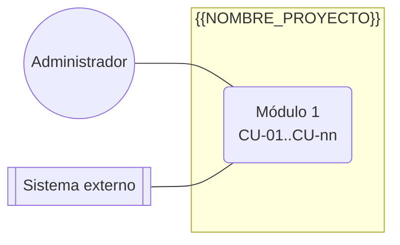

# Especificación de Requisitos de Software (SRS)
## {{NOMBRE_PROYECTO}}

| Campo | Valor |
|-------|-------|
| Versión | 0.1 (borrador) |
| Fecha | {{FECHA}} |
| Autor | {{AUTOR}} |
| Estado | Borrador: descubrimiento con el Product Owner |
| Estándar de referencia | ISO/IEC/IEEE 29148:2018 |

<!--
Cómo se mantiene este documento (skill devskills:redactar-srs y devskills:pasada-documental):
- Lo escribe el analista-arquitecto con el Product Owner, en ORDEN ESTRICTO: no se empieza un paso
  sin cerrar el anterior (1 → 2 → 3 → 4 → 5 → 6 → Anexo A → Anexo B → Anexo C). Todo pendiente se
  registra aquí mismo como P-nn en la sección 6.
- Cada pasada sube la versión y agrega una fila al historial (la más reciente arriba), con quién
  decidió cada cosa: **Decisiones del Product Owner** (negocio) y **Decisiones del orquestador**
  (técnicas, validadas o por validar por el Product Owner).
- Cuando no quedan pendientes que bloqueen el MVP se declara la **línea base** (nota de abajo).
  Desde ahí, todo cambio se registra en el historial y obliga a revisar los anexos afectados y a
  regenerar el Anexo C con `python documentacion/analisis/trazabilidad.py _tmp.md --escribir`.
- Nada se borra: un requisito, caso de uso o historia que sale del alcance se marca
  "**Retirado en X.Y**" (o "Retirada en X.Y" para una HU) y se conserva su texto anterior.
- Lo agregado después de validado un módulo se marca **para validar** hasta que el Product Owner lo valide.
- Nada propio de la empresa en el código: nombres, dominios, identificadores, horarios, cuentas o
  cualquier dato del negocio van en configuración, no en constantes.
-->

> **Línea base.** <!-- Cuando se cierre la línea base, escribe aquí: "Línea base X.Y. No quedan requisitos pendientes que bloqueen el MVP. Cualquier cambio a partir de aquí se registra en el historial y obliga a revisar los anexos afectados y a regenerar el Anexo C (`documentacion/analisis/trazabilidad.py`)." -->

### Historial de cambios
| Versión | Fecha | Cambios |
|---------|-------|---------|
| 0.1 | {{FECHA}} | Borrador inicial: problema de negocio, alcance y actores del descubrimiento |

---

## 1. Introducción

### 1.1 Propósito
<!-- Qué define este documento y para quién. Una o dos frases sobre qué hace el sistema.
Si el Product Owner fija un usuario principal, escríbelo aquí como "Usuario principal (decisión del Product Owner, versión X.Y)". -->

### 1.1.1 Problema de negocio (la necesidad real)
<!-- La necesidad real, con las palabras del negocio: qué pasa hoy, cuándo duele y a quién.
Distingue los hechos confirmados por el negocio (con la versión en que se confirmaron) de las suposiciones.
Cierra con "El objetivo principal del sistema es ..." y cómo cada función lo ataca. -->

#### Metas medibles del sistema
| Indicador | Línea base | Meta |
|-----------|-----------|------|
| <!-- indicador --> | <!-- valor medido o "No se registra" --> | <!-- meta numérica --> |

#### Línea base medida (<!-- AAAA-MM-DD a AAAA-MM-DD -->)
<!-- Fuente de los datos (sistema, tabla o archivo, solo lectura), población y periodo.
Los scripts y consultas de la medición van en documentacion/analisis/ y se citan en 1.4.
Si todavía no se mide, deja la tabla vacía y registra un P-nn. -->

| Indicador | Valor |
|-----------|-------|
| <!-- indicador --> | <!-- valor --> |

**Limitaciones de la medición:**
- <!-- qué datos faltan, qué no se pudo calcular y por qué, qué no confirman los datos -->

### 1.1.2 Contexto para la dirección (no son requisitos)
<!-- Opcional. Datos y argumentos para presentar el proyecto a la dirección. No generan requisitos. Borra la sección si no aplica. -->

### 1.2 Alcance
El sistema **{{NOMBRE_PROYECTO}}** va a permitir:
- <!-- capacidad 1 -->

**Fuera del alcance:**
- <!-- lo que expresamente no hace -->

### 1.3 Definiciones, acrónimos y abreviaturas
| Término | Definición |
|---------|------------|
| SRS | Especificación de Requisitos de Software |
| MVP | Producto mínimo viable |
| RF / RNF | Requisito funcional / no funcional |
| CU | Caso de uso |
| HU | Historia de usuario |
| EN | Habilitador técnico (trabajo del diseño que no es una historia de usuario) |
| DoR / DoD | Definición de Listo / Definición de Terminado |
| <!-- término del negocio --> | <!-- definición --> |

### 1.4 Referencias
- ISO/IEC/IEEE 29148:2018, Systems and software engineering — Requirements engineering.
- **Evidencia de la línea base (sección 1.1.1):** <!-- scripts y consultas en documentacion/analisis/ -->
- Prototipos de UI/UX: `documentacion/ui/prompts_figma_make.md` (prompts para Figma Make generados a partir de este SRS).
- **Diseño técnico:** `documentacion/DISENO.md` (documento de diseño, IEEE 1016). Describe **cómo** se implementan los requisitos de este SRS y los referencia por ID.
- **Plan de entregas:** `documentacion/PLAN.md` (Scrum, entregas incrementales y sprints), generado a partir de las historias del Anexo B con `documentacion/analisis/plan_sprints.py`.
- <!-- documentación de las integraciones externas -->

---

## 2. Descripción general

### 2.1 Perspectiva del producto
<!-- ¿Sistema nuevo o reemplazo? Diagrama de contexto con los actores y, solo si las hay, las integraciones
externas. No presupongas ninguna: un sistema puede no integrarse con nada. Ejemplos de contexto según el dominio:
inventarios (almacenistas, compras, quizá un lector de códigos), plataforma escolar (docentes, alumnos, tutores),
recursos humanos (colaboradores, jefes, quizá la nómina como sistema externo). -->

```
 <!-- Usuarios ──► {{NOMBRE_PROYECTO}}        (agrega cada sistema externo y el sentido del flujo, si existe) -->
```

### 2.2 Funciones principales
1. <!-- función -->

### 2.3 Clases de usuarios
| Rol | Descripción | Responsabilidades principales |
|-----|-------------|-------------------------------|
| Administrador | Gestiona el sistema | Usuarios, roles y configuración |
| <!-- rol --> | <!-- descripción --> | <!-- responsabilidades --> |

<!-- El esqueleto solo trae el rol Administrador. Los demás roles salen del descubrimiento de ESTE proyecto
(quién usa el sistema y qué decide cada quien); esta tabla es la fuente del catálogo de roles que se carga en
`identidad` y de la matriz de permisos. Marca qué roles exigen segundo factor. -->

<!-- Un usuario puede tener más de un rol. Anota la separación de funciones si aplica y el volumen estimado de usuarios concurrentes. -->

### 2.4 Entorno operativo
- Aplicación web **responsiva** para los usuarios internos, usable desde computadora, tablet y celular. <!-- ajusta -->
- <!-- navegadores, idiomas, zonas horarias, países -->

### 2.5 Restricciones de diseño e implementación
<!-- Una restricción por línea, numerada R-nn. No se renumeran: si una sale, se marca retirada. -->
- **R-01** <!-- restricción -->
- **R-nn** Portabilidad: los componentes se **despliegan** en contenedores (Docker Compose) y la configuración va por variables de entorno. Para desarrollar y probar, Docker no es necesario.

### 2.6 Supuestos y dependencias
<!-- Supuestos, dependencias externas y riesgos aceptados, numerados S-nn. Un riesgo aceptado lleva su mitigación y la versión en que se aceptó: "**Riesgo aceptado (versión X.Y):** ...". -->
- **S-01** <!-- supuesto o dependencia -->

### 2.7 Arquitectura y stack propuestos
El criterio es **seguridad, mantenibilidad y escalabilidad**. El stack es el del esqueleto de DevSkills (fijo para todos los proyectos):

| Componente | Tecnología | Justificación |
|------------|-----------|---------------|
| Backend principal | **Python 3.12+ / Django 5 + Django REST Framework** | Autenticación, permisos, protección CSRF/XSS/SQLi, panel de administración y migraciones, con historial de seguridad maduro y LTS |
| Tareas asíncronas | Celery + Redis (`worker`, `worker-outbox` y `beat`) | Envíos hacia afuera por outbox, tareas programadas y procesos largos fuera de la petición |
| Base de datos | PostgreSQL 16 | Robusta, open source y con equivalente administrado en todas las nubes. Un esquema por módulo |
| Frontend | HTML + CSS + plantillas Django + HTMX | Sin el costo de un framework SPA. Responsivo |
| Proxy y TLS | nginx + certificado TLS | HTTPS obligatorio |
| Despliegue | Docker Compose (desarrollo, pruebas y producción) | Portabilidad: lo que cambia entre entornos está en variables de entorno |
| <!-- servicio interno opcional (p. ej. FastAPI) --> | <!-- tecnología --> | <!-- por qué va separado --> |

**Estilo arquitectónico:** un **monolito modular** con arquitectura hexagonal (puertos y adaptadores) por módulo. Cada módulo es dueño de sus datos; lo externo va detrás de un puerto. El detalle está en `DISENO.md` (D.1).

```
                 ┌──────────────── Servidor ────────────────────────────┐
 Usuarios (web) ─┤► nginx ─► Django (monolito modular) ─► PostgreSQL     │
                 │               │                                       │
                 │               └──► Redis ◄── Celery (worker, outbox,  │
                 │                              beat)                    │
                 └───────────────────────────────┬───────────────────────┘
                                                 └──► <!-- sistemas externos -->
```

### 2.8 Modos y estados del sistema
<!-- ISO/IEC/IEEE 29148 pide describir los modos de operación cuando los requisitos dependen de ellos. Lista
cada modo, qué funciones tiene disponibles y cómo se entra y se sale. Si el sistema tiene un solo modo,
escribe "Un solo modo de operación" y borra la tabla. Los estados de las ENTIDADES (un pedido, una solicitud)
no van aquí: van en el DISEÑO D.3. -->

| Modo | Cuándo está activo | Funciones disponibles | Cómo se entra y se sale |
|------|--------------------|-----------------------|-------------------------|
| Operación normal | Siempre que todo responde | Todas | Estado por defecto |
| <!-- Degradado (p. ej. un sistema externo caído) --> | <!-- condición --> | <!-- qué sigue funcionando y qué se encola --> | <!-- detección y recuperación --> |
| <!-- Mantenimiento --> | <!-- ventana programada --> | <!-- solo lectura / ninguna --> | <!-- quién lo activa --> |

---

## 3. Requisitos funcionales

Prioridad: **A** = imprescindible (MVP), **M** = importante, **B** = deseable. Un requisito fuera del MVP a propósito lleva prioridad "Fase 2" (o se lista en `documentacion/analisis/trazabilidad.json`); uno retirado, "Retirado en X.Y".

### 3.0 Atributos de cada requisito
<!-- ISO/IEC/IEEE 29148 pide que cada requisito (RF y RNF) tenga, además de su texto y prioridad, su FUENTE, su
JUSTIFICACIÓN, su MÉTODO DE VERIFICACIÓN y su ESTADO. Se llevan en esta tabla aparte, una fila por requisito, y
NO como columnas de las tablas de requisitos de abajo: `trazabilidad.py` lee esas tablas con 3 columnas
(ID, requisito, prioridad). Por eso el ID va entre comillas invertidas en esta tabla (así el generador no la
confunde con la definición del requisito). Se llena junto con cada requisito y se revisa en cada pasada. -->

- **Fuente:** de dónde sale (una persona o rol del negocio, un documento, una norma, una restricción `R-nn`, un pendiente `P-nn` resuelto).
- **Justificación:** por qué existe (qué meta de 1.1.1 sirve o qué riesgo evita).
- **Verificación:** **Prueba** (automatizada o manual), **Inspección** (revisión de artefactos), **Análisis** (cálculo o modelo) o **Demostración** (operación observada). El detalle técnico de los RNF va en `trazabilidad.json` (Anexo C.3).
- **Estado:** **Propuesto** → **Aprobado** (lo aprobó el Product Owner, con versión) → **Implementado** → **Verificado**; o **Retirado en X.Y**.

| ID | Fuente | Justificación | Verificación | Estado |
|----|--------|---------------|--------------|--------|
| `<!-- RF-ABC-01 -->` | <!-- Product Owner, versión 0.1 --> | <!-- meta que sirve --> | <!-- Prueba --> | <!-- Propuesto --> |

<!-- Una subsección por módulo, con prefijo de tres o más letras propio del módulo (RF-ABC-nn).
Cada requisito: "El sistema debe ..." o "El <rol> debe poder ...", verificable y sin decir cómo.
No se renumeran: los nuevos van al final del módulo. Si una versión cambia un requisito, escribe
"**Versión X.Y:** ..." dentro del texto. Retirado: "**Retirado en X.Y**: motivo. *Texto anterior:* ...". -->

### 3.1 <!-- Módulo --> (RF-<!-- ABC -->)
| ID | Requisito | Prioridad |
|----|-----------|-----------|
| <!-- RF-ABC-01 --> | <!-- El sistema debe ... --> | <!-- A --> |

### 3.n Administración (RF-ADM)
<!-- El esqueleto de DevSkills ya trae el módulo identidad (usuarios, roles, ingreso con contraseña
Argon2, bloqueo por intentos, sesión con tope, segundo factor TOTP, gestión de usuarios, aviso por
reuso del código). NO trae bitácora de auditoría: el módulo `auditoria` es un molde vacío y la capacidad
y el rol `auditor` son ejemplos. Si el proyecto necesita una bitácora, es un requisito suyo (RF y RNF)
y un elemento del plan. Si usa lo que sí trae el esqueleto, sus requisitos van aquí y se trazan a las
historias de la Entrega 0. -->
| ID | Requisito | Prioridad |
|----|-----------|-----------|
| <!-- RF-ADM-01 --> | <!-- El sistema debe permitir al Administrador crear, editar y desactivar usuarios. --> | <!-- A --> |

---

## 4. Requisitos no funcionales

| ID | Categoría | Requisito |
|----|-----------|-----------|
| <!-- RNF-01 --> | <!-- Rendimiento | Seguridad | Disponibilidad | Privacidad | Usabilidad | Mantenibilidad | Portabilidad | Respaldo | Escalabilidad | Internacionalización --> | <!-- requisito medible --> |

<!-- Cada RNF necesita una verificación técnica (prueba o revisión) que se escribe en
documentacion/analisis/trazabilidad.json y aparece en el Anexo C.3. -->

### 4.1 Cumplimiento normativo y legal
<!-- Las leyes, normas y políticas que el sistema debe cumplir y qué requisitos las cubren. No des por hecha
ninguna: confírmalas con el Product Owner y, si hace falta, con el área legal o de cumplimiento. "No aplica"
también es una respuesta y se justifica. Lo que no se pueda confirmar queda como P-nn. -->

| Norma, ley o política | ¿Aplica? | Qué exige al sistema | Requisitos que la cubren | Quién lo confirmó |
|-----------------------|----------|----------------------|--------------------------|-------------------|
| <!-- protección de datos personales de tu país o región --> | <!-- Sí | No | Por confirmar (P-nn) --> | <!-- consentimiento, derechos del titular, retención --> | <!-- RNF-nn, RF-ABC-nn --> | <!-- rol, versión --> |
| <!-- política interna de seguridad / auditoría --> | <!-- --> | <!-- --> | <!-- --> | <!-- --> |
| <!-- normas del sector (financiero, salud, educación…) --> | <!-- --> | <!-- --> | <!-- --> | <!-- --> |

---

## 5. Interfaces externas

<!-- Si el sistema no se integra con nada, deja solo la interfaz de usuario y escribe "Sin integraciones externas en el MVP". -->

### 5.1 <!-- Sistema externo (una subsección por cada uno; bórrala si no hay) -->
<!-- Qué se envía y se recibe, mecanismo (API, webhook, base de datos en solo lectura), credenciales necesarias y quién las provee. -->

### 5.n Interfaz de usuario interna
<!-- Pantallas principales, idioma, accesibilidad (contraste AA, teclado), modo claro y oscuro. Los prototipos van en documentacion/ui/prompts_figma_make.md. -->

---

## 6. Pendientes de definición

<!-- Toda pregunta abierta va aquí con un ID P-nn que no se reutiliza. Las preguntas al Product
Owner se hacen con la skill devskills:preguntar-al-po (decisiones numeradas con opción recomendada).
Estados: **Abierto**, **Resuelto**: <respuesta y versión>, **Descartado**, **Dependencia externa**
(no bloquea el SRS, sí la puesta en producción), **Resuelto y actualizado en la versión X.Y**.
Al resolver, deja la respuesta en la columna Estado y propágala a RF, CU y HU en la misma versión.
Si un cambio de alcance abre varios pendientes juntos, agrúpalos en una subsección
"#### Pendientes abiertos por el cambio de alcance de la versión X.Y". -->

| # | Tema | Pregunta | Estado |
|---|------|----------|--------|
| P-01 | <!-- tema --> | <!-- pregunta --> | **Abierto** |

---

## Anexo A. Modelo de casos de uso

> **Plan de la etapa:** A.1 Actores → A.2 Diagrama general → A.3 Catálogo de casos de uso → (Anexo B) Historias de usuario con criterios Gherkin por módulo → (Anexo C) Matriz de trazabilidad RF ↔ CU ↔ HU.
> Cada paso se cierra y se valida antes de pasar al siguiente.

### A.1 Actores

| ID | Actor | Tipo | Descripción |
|----|-------|------|-------------|
| AC-01 | Usuario interno | Humano (abstracto) | Generalización de todos los roles internos: inicia sesión y usa la aplicación web |
| AC-02 | Administrador | Humano | Especialización de AC-01 |
| <!-- AC-nn --> | <!-- actor --> | <!-- Humano | Humano externo | Sistema externo | Sistema interno | Sistema (tiempo) --> | <!-- descripción --> |

<!-- Un temporizador (procesos programados) es un actor de tipo "Sistema (tiempo)". El propio sistema no es actor. -->

### A.2 Diagrama general (actores ↔ módulos)



### A.3 Catálogo de casos de uso

Las relaciones se indican como **«include»** (siempre ocurre) y **«extend»** (ocurre bajo una condición).

<!-- Una tabla por módulo, en el mismo orden que la sección 3. La última columna ("Requisitos") la
lee trazabilidad.py: lista los RF y RNF, admite rangos "RF-ABC-02 a RF-ABC-06". Un caso de uso
retirado conserva su fila con "(**Retirado en X.Y**: lo reemplaza CU-nn)" en el nombre. -->

#### Módulo 1: <!-- nombre -->
| ID | Caso de uso | Actor principal | Actores secundarios | Relaciones | Requisitos |
|----|-------------|-----------------|---------------------|------------|------------|
| <!-- CU-01 --> | <!-- verbo + objeto --> | <!-- actor --> | <!-- — --> | <!-- «include» CU-nn; «extend» CU-nn (condición) --> | <!-- RF-ABC-01, RNF-nn --> |

---

## Anexo B. Historias de usuario del MVP

### B.0 Convenciones

**Alcance:** las historias cubren el **MVP**. <!-- Indica qué módulos y qué requisitos quedan fuera (fase 2). -->

**Formato de cada historia:**

| Campo | Contenido |
|-------|-----------|
| ID | HU-NN, numeradas por orden de módulo. Una historia nueva toma el siguiente número libre, aunque quede en otro módulo |
| Historia | **Como** [rol] **quiero** [acción] **para** [beneficio] |
| Prioridad | La del requisito de mayor prioridad que cubre (A, M o B) |
| Trazabilidad | Caso o casos de uso (CU) y requisitos (RF/RNF) |
| Criterios de aceptación | Escenarios en **Gherkin en español** (Característica, Escenario, Dado, Cuando, Entonces, Y). Cada escenario se convierte en una prueba automatizada |

**Definición de Listo (DoR):** una historia entra a desarrollo solo si tiene trazabilidad a un RF, criterios de aceptación verificables y ningún pendiente abierto que la afecte.

**Definición de Terminado (DoD):** la **común del método** vive en un solo lugar, la skill `devskills:proyecto-contexto` (escenarios Gherkin automatizados y en verde, análisis de seguridad y límites de módulos en verde, RNF verificados, QA sin observaciones —en el cierre del sprint, o por historia en los elementos de seguridad, plataforma o críticos—, Angel Fixer sin hallazgos de ninguna severidad, verificación final y avance registrado); no se copia aquí para que no diverja. **Criterios propios de este proyecto** (si los hay, solo lo que se suma): <!-- p. ej. "la bitácora registra las acciones relevantes" SOLO si este proyecto construye una bitácora (el esqueleto no la trae) -->.

**Orden de trabajo:** un módulo a la vez, en el orden del Anexo A. Cada módulo se valida antes de pasar al siguiente.

| Módulo | Historias | Estado |
|--------|-----------|--------|
| 1. <!-- módulo --> | <!-- HU-01 a HU-nn --> | <!-- Para validar | Validado | Validado (HU-nn agregada en la versión X.Y, **para validar**) --> |

### B.1 Módulo 1: <!-- nombre -->

<!-- Ejemplo de historia (copia el formato; las líneas de Gherkin no se comentan en las historias reales):

#### HU-01 Iniciar sesión de forma segura
**Como** usuario interno **quiero** entrar con mi correo y mi contraseña de forma segura **para** que nadie más pueda usar mi cuenta.
- **Prioridad:** A · **Trazabilidad:** CU-01 · RF-ADM-01, RNF-01
> Versión X.Y: nota de alcance o de cambio, si aplica.

```gherkin
Característica: Autenticación con contraseña

  Escenario: Ingreso correcto
    Dado que tengo una cuenta activa
    Cuando ingreso mi correo y mi contraseña correctos
    Entonces entro a la aplicación con los permisos de mis roles
    Y el ingreso queda registrado

  Escenario: No se revela si el correo existe
    Cuando intento ingresar con un correo que no existe
    Entonces veo "Correo o contraseña incorrectos"
    Y es el mismo mensaje que al ingresar un correo existente con una contraseña incorrecta
```

Reglas: escenarios concretos con datos ficticios, uno por regla o camino de error; incluye
permisos denegados, datos inválidos y sistema externo caído cuando apliquen. Una historia
retirada conserva su título con "(Retirada en X.Y)" y su texto. Si una historia supera 13 puntos
al estimarla, se parte en dos (skill devskills:planear-entregas).
-->

---

## Anexo C. Matriz de trazabilidad

> Se genera con `python documentacion/analisis/trazabilidad.py _tmp.md --escribir` cuando existan los Anexos A y B. No se edita a mano.
